---

## Hi there! 

I'm **Reshma**, a full stack developer working with the **MERN stack** (MongoDB, Express, React, Node.js).

I build web apps end to end, from REST APIs and authentication to real-time features and deployment on AWS. Recently I built **[BEAUTÉ](https://github.com/Resshh/Salon-Management-System)**, a salon booking platform with payments, loyalty points and live notifications.

I also have hands-on experience with cloud deployment on AWS, CI/CD pipelines with Jenkins, and application security.

**Let's connect!**

## 🛠️ Tech

   
   
  

<b>Show as a list</b>

**Frontend:** React · Vite · Tailwind CSS · HTML/CSS · JavaScript
**Backend:** Node.js · Express · REST APIs · JWT · Socket.IO
**Database:** MongoDB · Mongoose
**Tools:** Git · AWS · Jenkins · Figma

## 📊 GitHub stats

  
  

  

